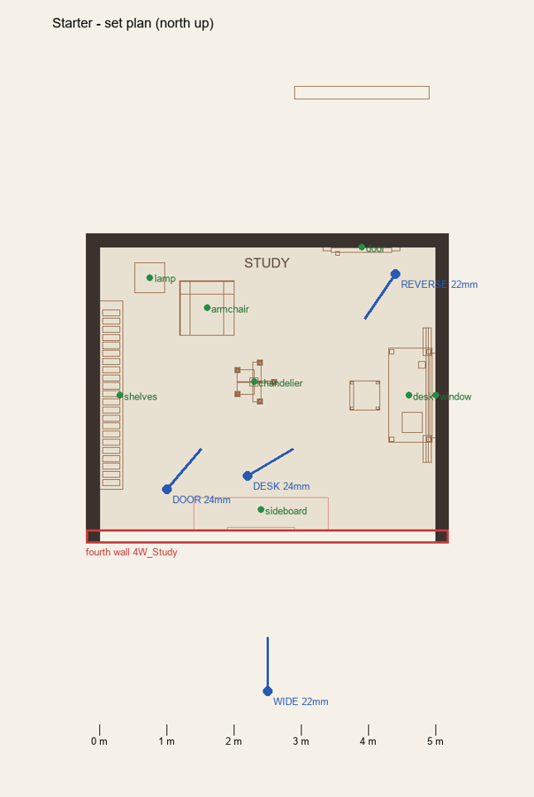
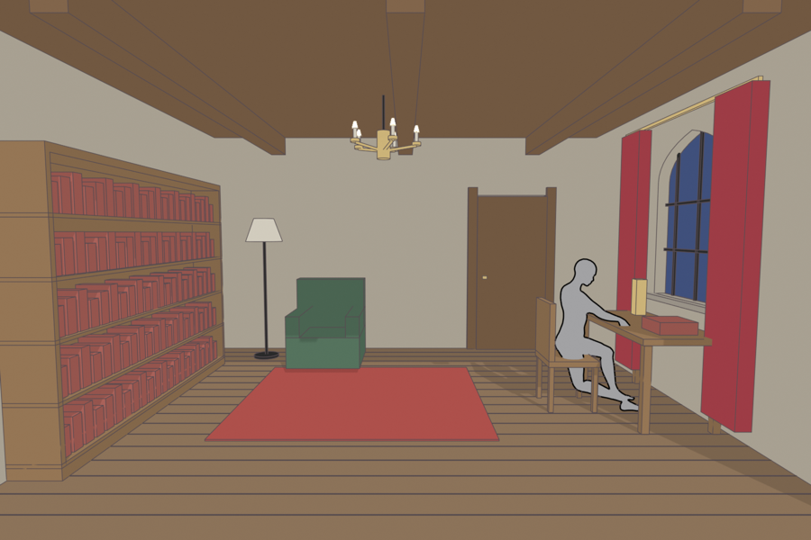
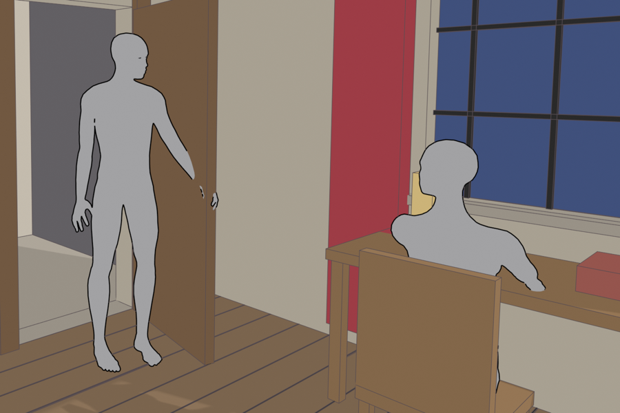
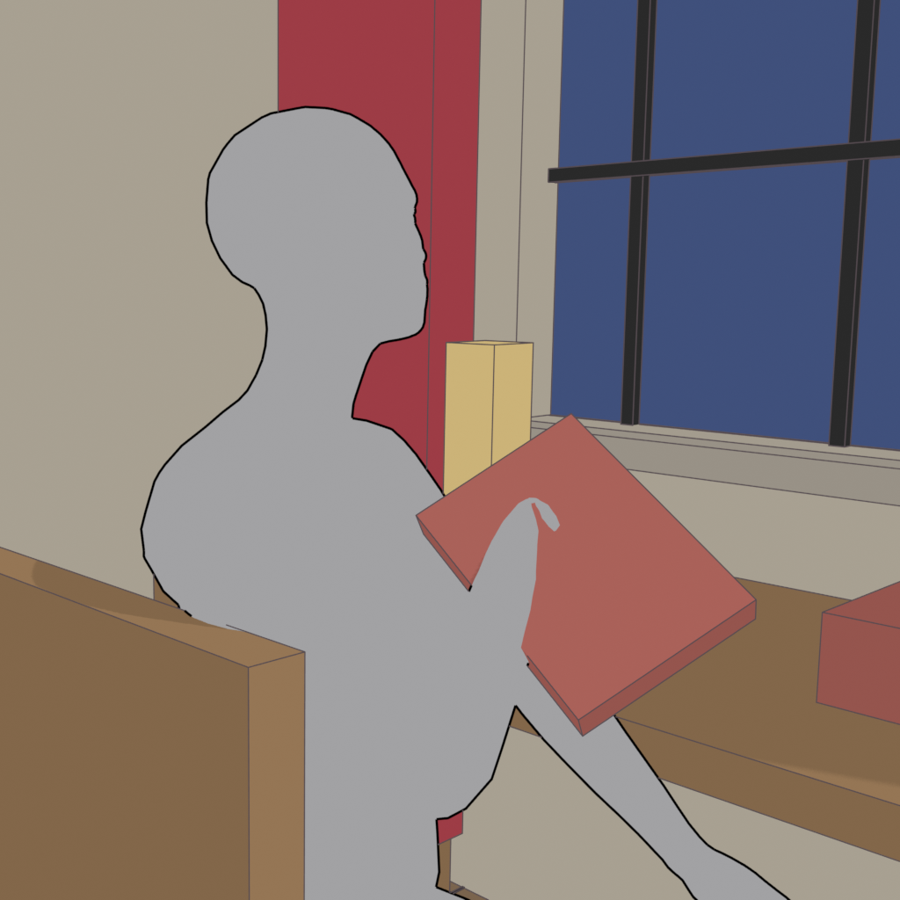

# comicblock

Make comic panels that stay consistent from panel to panel: the same room, the same camera geography, the true
heights of the cast.

**Blender decides structure** (set, camera, true scale, poses, props). **An image model decides appearance**
(likeness, costume, style). The hand-off is one image: a grey-mannequin blockout of the panel, sent as the first
reference along with your character sheets.

| Floor plan and camera plot | Wide (fixed 22 mm plot camera) |
| --- | --- |
|  |  |
| **Two-shot (auto dolly-in to 35 mm)** | **Close-up with a held prop** |
|  |  |

*Blockouts from the included starter example. The image model redraws each one with your characters and style.*

The method was proven in production on a 25-page comic issue, and confirmed in a second, unrelated visual style.
See [docs/METHOD.md](docs/METHOD.md) for the full procedure, failure modes and costs.

## Who it's for

**Artists using Claude Code.** You describe the scene, and Claude writes the staging, runs Blender, shows you the
blockouts and results, and follows the rules in the [comicblock skill](.claude/skills/comicblock/SKILL.md). You
don't need to write code.

**Coders.** You can also drive everything with the `comicblock` command line and plain Python files.

## Requirements

- **Blender 4.2 or newer.** 5.1 is tested. It runs headless, so you never have to open it.
- **MPFB**, the MakeHuman extension for Blender. In Blender, go to Edit > Preferences > Get Extensions, search
  for "MPFB", and click Install. MPFB is GPL-licensed and is not bundled here; you install it yourself.
- **Python 3.9+** with `pip install -r requirements.txt` (PyYAML, Pillow, numpy).
- **Character sheets** for each character: one or two approved images (a full body, plus a head or expressions).
  They are the only source of likeness and style, so they decide the quality of everything.
- **An image model that accepts several reference images** and follows the layout of the first:
  - Built in: [Scenario](https://www.scenario.com) (GPT Image 2.5 Sunburst by default), which needs an API key.
  - The **manual** mode needs no API: it prepares the prompt and references for any web tool that takes multiple
    reference images.

## Quick start (with Claude Code)

```
git clone <this repo> comicblock
cd comicblock
pip install -r requirements.txt
claude
```

Then ask: *"Check my setup and walk me through the starter example."* Claude will run the checks, build the
example set, stage its three panels, and show you each blockout. Then ask: *"Start a new project for my comic"*.

## Quick start (command line)

```
python -m comicblock doctor   examples/starter      # checks Blender, MPFB, packages, sheets
python -m comicblock build    examples/starter      # set + cast -> build/set.blend, build/plan.png (~15 s)
python -m comicblock plot     examples/starter      # empty-set renders from each plot camera
python -m comicblock stage    examples/starter all  # blockouts -> blockout/1.png, 2.png, 3.png (~10 s)
python -m comicblock prompt   examples/starter 2    # the exact prompt and references; spends nothing
python -m comicblock generate examples/starter 2 --provider manual   # or scenario, once configured
python -m comicblock import   examples/starter 2 result1.png result2.png
python -m comicblock review   examples/starter all  # blockout beside outputs -> review/*.png
```

Going from a clone to a first generated panel should take about an hour, most of it installing Blender and MPFB
and preparing sheets.

## A project

A project is a folder. Copy `examples/starter` to start one.

```
my-comic/
  project.yaml      characters (name, height, one-line look, sheets), style block, set features + cameras,
                    image model and credentials path, output folders
  set.py            builds the location with the kit (walls, doors, windows, furniture as simple shapes)
  panels.py         one staging spec per panel: camera, cast marks, poses, gaze, props, framing, action text
  props.py          (optional) your own prop builders
  sheets/           character sheets
  build/            set.blend, plan.png, plot renders           (generated)
  blockout/         <id>.png + <id>.json per panel               (generated)
  gen/              <id>_1.png, <id>_2.png, gen.json log          (generated)
```

## Image models and providers

Set `generation.provider` in `project.yaml`, or pass `--provider`:

| Provider | What it does | Cost |
| --- | --- | --- |
| `dry` | Prints the prompt and the ordered references | Free |
| `manual` | Writes `manual/<id>/` with `prompt.txt` and the references numbered in order, for any web tool; bring results back with `import` | Whatever the tool charges |
| `scenario` | Uploads the references (cached), generates, downloads, and logs job IDs and cost | See below |

On Scenario, switching to another model is one line (`generation.model`). Adding a different service means
writing one small class (upload, generate, collect) in `comicblock/providers/`; see `providers/base.py`.

**Scenario credentials:** put a CSV with the columns `id,secret` somewhere outside this repo, and point
`generation.credentials` at it (the default is `~/.comicblock/scenario.csv`). Alternatively, set
`SCENARIO_API_KEY` and `SCENARIO_API_SECRET`. Also set `scenario_project`, or `SCENARIO_PROJECT_ID`.

## Cost expectations

Figures are from production use on Scenario (Oct-Nov 2026). Check current prices: credit units (CU) are
Scenario's billing unit.

- **About 25 CU per panel** for two outputs on GPT Image 2.5 Sunburst. GPT Image 2 was about 95 CU.
- Allow about 1.15x that for ordinary panels and about 1.7x for hard ones (hand contact, handedness, unusual
  props), plus 10-15% for reruns.
- **Refusals still charge.** The flat-grey, outline-only mannequins exist to pass content filters.
- **Plan caps:** Scenario's team plan caps API generation. The tool stops at the first HTTP 429 and shows you the
  message; don't retry in a loop.
- Blockout renders are free and take seconds. Your real cost per panel is the time spent writing the staging and
  reviewing the results.
- To save credits:
  - generate one output for close-ups
  - paint over small fixes
  - restage before rerunning (most failed reruns trace back to the blockout)

## Body fitting (optional)

If you have a 3D model of a character's design (for example a T-pose from an image-to-3D tool), export it as OBJ
and run:

```
python -m comicblock fit <project> <character> design.obj --up y
```

It matches MPFB's body shape to the design by horizontal cross-sections, then writes `cast/<character>.fit.json`,
which the next `build` uses. Otherwise, set MPFB macros by hand in `project.yaml` and compare against the sheet.

## Licence

comicblock is released under the MIT licence; see [LICENSE](LICENSE).

MPFB/MakeHuman (GPL) is a separate install that you add to Blender, and no MPFB code or data ships here. Your
sets, sheets and panels are yours. The starter's placeholder sheets are drawn by `tools/make_placeholder_sheets.py`
and are MIT-licensed like the rest.
